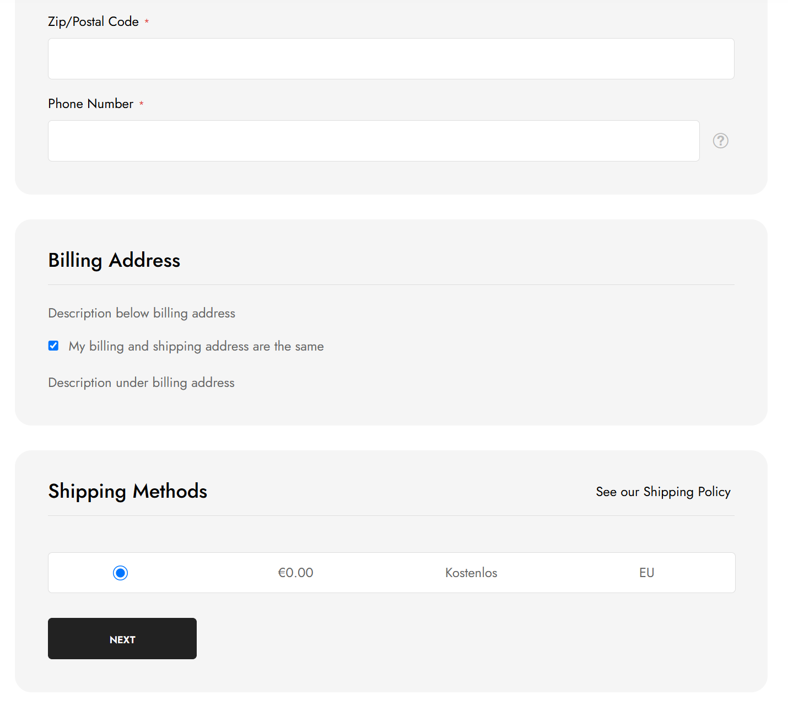
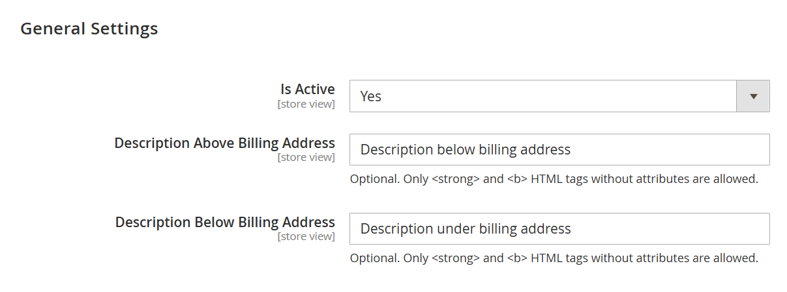

# Grinet_BillingAddressAtShipping

**Author :** Hidayet OK @ grinet

**Forked From :** [collabpl/magento2-module-checkout-billing-at-shipping](https://github.com/collabpl/magento2-module-checkout-billing-at-shipping) — Marcin Jędrzejewski

[English](#english) | [Türkçe](#türkçe)



## English

### Overview

A Magento 2 module that places the billing address immediately below the shipping address and before shipping methods in the standard checkout. Customers can use the shipping address for billing, select a saved address, or enter a new billing address.

- Optional descriptions above and below the billing address.
- Only attribute-free `<strong>` and `<b>` HTML tags are allowed in descriptions. Unsupported tags and attributes are rejected when saving in Admin; output is also escaped before rendering.
- Responsive billing card with spacing, background and rounded corners matching the Theraline checkout design.
- Required-field validation and a save-to-address-book option for signed-in customers.
- Virtual-only carts retain the native billing-address placement.
- When **Is Active** is disabled, the module does not move the billing address.
- PayPal shipping-summary compatibility supplies `isStorePickup()` if the optional pickup module is disabled, while preserving an existing implementation.

### Requirements and installation

Requires PHP 8.1 or later and `magento/module-checkout` version `100.4.*`, as declared in `composer.json`. The module uses Magento's standard Knockout checkout; compatibility with alternative checkout implementations must be checked separately.

Place the module in `app/code/Grinet/BillingAddressAtShipping`, then run the following commands from the Magento root using the PHP CLI version matching the store:

```sh
# Only if the Collab module is installed and enabled:
php bin/magento module:disable Collab_CheckoutBillingAtShipping

php bin/magento module:enable Grinet_BillingAddressAtShipping
php bin/magento setup:upgrade
php bin/magento cache:clean config layout block_html full_page
```

Do not run both billing-address modules together: they modify the same checkout. Grinet has no runtime dependency on Collab.

In production mode, compile dependency injection and deploy static assets for the installed themes and locales through the site's deployment process. Refresh the static asset version when deploying frontend changes so browsers do not reuse the previous module's RequireJS configuration.

The feature is disabled by default. Enable **Is Active** after installation.

### Configuration

**Stores → Configuration → Grinet → Billing Address at Shipping → General Settings**

A shortcut is also available under **Stores → Settings → Billing Address at Shipping**. Settings support default, website and store-view scopes.

All field paths below use the prefix `grinet_billing_address_at_shipping/general/`.

| Field | Configuration key | Description |
| --- | --- | --- |
| Is Active | `is_active` | Enable or disable moving the billing address. Default: No. |
| Description Above Billing Address | `description_above` | Optional text below the billing title and above the address controls. Default: empty. |
| Description Below Billing Address | `description_below` | Optional text below the address controls or expanded form. Default: empty. |

Example description:

```html
Please check your <strong>billing address</strong> before continuing.
```

Leave either description empty to hide it. Links, images, other HTML tags, and attributes such as `class`, `style` or `onclick` are not allowed.

### Screenshots

The checkout screenshot at the top shows the billing address between the shipping address and shipping methods. The descriptions shown are sample configuration values, not built-in text.

Admin configuration:



### Verification

Run the automated checks listed in [Test commands](#test-commands--test-komutları). For checkout acceptance testing, cover guest and signed-in customers, same-as-shipping, saved and new billing addresses, required fields, saving to the address book, returning from payment, page reload, virtual-only carts, the disabled setting, and empty/valid/rejected description HTML. Check expanded and collapsed forms on desktop and mobile. In a test environment, verify the billing and shipping addresses saved on a test order.

### Attribution and license

This module was forked from [collabpl/magento2-module-checkout-billing-at-shipping](https://github.com/collabpl/magento2-module-checkout-billing-at-shipping) and further developed by Grinet. Enhancements include Grinet admin configuration, optional descriptions with restricted HTML, responsive billing-card styling, improvements to address validation and selection, and PayPal shipping-summary compatibility.

Thank you to the Collab team and the original author, Marcin Jędrzejewski, for creating and sharing the original module as open source.

Original copyright notices are retained. See [LICENSE.md](LICENSE.md) for the MIT license.

## Türkçe

### Genel bakış

Standart Magento 2 ödeme akışında fatura adresini teslimat adresinin hemen altına, kargo yöntemlerinin üstüne taşıyan modüldür. Müşteri teslimat adresini fatura adresi olarak kullanabilir, kayıtlı bir adres seçebilir veya yeni bir fatura adresi girebilir.

- Fatura adresinin üstüne ve altına isteğe bağlı açıklamalar eklenebilir.
- Açıklamalarda yalnızca özniteliksiz `<strong>` ve `<b>` HTML etiketlerine izin verilir. Diğer etiketler ve öznitelikler yönetim panelinde kaydedilirken reddedilir; çıktı ayrıca gösterilmeden önce güvenli biçimde işlenir.
- Fatura bölümü, Theraline checkout tasarımına uygun boşluklara, arka plana ve yuvarlatılmış köşelere sahiptir; mobil ekrana uyum sağlar.
- Zorunlu alan doğrulaması ve oturum açmış müşteriler için adres defterine kaydetme seçeneği bulunur.
- Yalnızca sanal ürün içeren sepetlerde standart fatura adresi konumu korunur.
- **Is Active** kapalıyken modül fatura adresini taşımaz.
- İsteğe bağlı mağazadan teslim modülü kapalıyken PayPal teslimat özetinin ihtiyaç duyduğu `isStorePickup()` fonksiyonu sağlanır; mevcut bir uygulama varsa korunur.

### Gereksinimler ve kurulum

`composer.json` dosyasına göre PHP 8.1 veya üzeri ve `100.4.*` sürümünde `magento/module-checkout` gereklidir. Modül, Magento'nun standart Knockout checkout yapısını kullanır; alternatif checkout uygulamalarıyla uyumluluk ayrıca kontrol edilmelidir.

Modülü `app/code/Grinet/BillingAddressAtShipping` dizinine yerleştirin. Ardından mağazanın PHP sürümüne uygun CLI ile Magento kök dizininde şu komutları çalıştırın:

```sh
# Yalnızca Collab modülü kurulu ve etkinse:
php bin/magento module:disable Collab_CheckoutBillingAtShipping

php bin/magento module:enable Grinet_BillingAddressAtShipping
php bin/magento setup:upgrade
php bin/magento cache:clean config layout block_html full_page
```

İki fatura adresi modülünü aynı anda çalıştırmayın; ikisi de aynı checkout alanını değiştirir. Grinet modülünün çalışması için Collab modülüne ihtiyaç yoktur.

Production modunda, sitenin dağıtım sürecine uygun şekilde bağımlılık enjeksiyonu derlemesini ve kullanılan tema/diller için statik içerik dağıtımını yapın. Ön yüz değişikliklerini dağıtırken statik dosya sürümünü yenileyin; böylece tarayıcılar önceki modülün RequireJS yapılandırmasını önbellekten kullanmaz.

Özellik varsayılan olarak kapalıdır. Kurulumdan sonra **Is Active** ayarını etkinleştirin.

### Yapılandırma

**Stores → Configuration → Grinet → Billing Address at Shipping → General Settings**

Ayrıca **Stores → Settings → Billing Address at Shipping** altında bir kısayol bulunur. Ayarlar varsayılan, web sitesi ve mağaza görünümü düzeylerinde yapılandırılabilir.

Aşağıdaki ayar anahtarlarının ortak öneki: `grinet_billing_address_at_shipping/general/`.

| Alan | Ayar anahtarı | Açıklama |
| --- | --- | --- |
| Is Active | `is_active` | Fatura adresinin taşınmasını açar veya kapatır. Varsayılan: Hayır. |
| Description Above Billing Address | `description_above` | Fatura başlığının altında, adres kontrollerinin üstünde gösterilen isteğe bağlı metin. Varsayılan: boş. |
| Description Below Billing Address | `description_below` | Adres kontrollerinin veya açık adres formunun altında gösterilen isteğe bağlı metin. Varsayılan: boş. |

Örnek açıklama:

```html
Devam etmeden önce <strong>fatura adresinizi</strong> kontrol edin.
```

Gösterilmesini istemediğiniz açıklamayı boş bırakın. Bağlantılar, görseller, diğer HTML etiketleri ve `class`, `style`, `onclick` gibi öznitelikler kullanılamaz.

### Ekran görüntüleri

Sayfanın başındaki checkout görseli, fatura adresinin teslimat adresi ile kargo yöntemleri arasındaki konumunu gösterir. Görseldeki açıklamalar örnek ayar değerleridir; modüle sabit olarak eklenmiş metinler değildir.

Yönetim paneli ayarları:


### Doğrulama

Otomatik kontroller için [Test komutları](#test-commands--test-komutları) bölümünü kullanın. Checkout kabul testlerinde misafir ve oturum açmış müşterileri, teslimat adresiyle aynı adres kullanımını, kayıtlı ve yeni fatura adreslerini, zorunlu alanları, adres defterine kaydetmeyi, ödeme adımından geri dönüşü, sayfa yenilemeyi, yalnızca sanal ürün içeren sepetleri, kapalı ayarı ve boş/geçerli/reddedilen açıklama HTML'lerini kontrol edin. Formun açık ve kapalı hâllerini masaüstünde ve mobilde inceleyin. Test ortamında oluşturulan siparişin fatura ve teslimat adreslerini doğrulayın.

### Kaynak ve lisans

Bu modül, [collabpl/magento2-module-checkout-billing-at-shipping](https://github.com/collabpl/magento2-module-checkout-billing-at-shipping) projesinden fork alınarak Grinet tarafından geliştirilmiştir. Grinet yönetim paneli ayarları, sınırlı HTML desteğiyle isteğe bağlı açıklamalar, mobil uyumlu fatura adresi kutusu, adres doğrulama ve seçim iyileştirmeleri ile PayPal teslimat özeti uyumluluğu eklenmiştir.

Orijinal modülü geliştirip açık kaynak olarak paylaştıkları için Collab ekibine ve modülün yazarı Marcin Jędrzejewski’ye teşekkür ederiz.

Orijinal telif hakkı bildirimleri korunmuştur. MIT lisansı için [LICENSE.md](LICENSE.md) dosyasına bakın.

## Test commands / Test komutları

Run from the Magento root with the appropriate PHP CLI and Node.js. PHPUnit must be installed in the project. / Magento kök dizininde uygun PHP CLI ve Node.js ile çalıştırın. Projede PHPUnit kurulu olmalıdır.

```sh
php vendor/bin/phpunit --do-not-cache-result --bootstrap app/bootstrap.php app/code/Grinet/BillingAddressAtShipping/Test/Unit/CheckoutTest.php
node app/code/Grinet/BillingAddressAtShipping/Test/JavaScript/billing-address.test.js
node app/code/Grinet/BillingAddressAtShipping/Test/JavaScript/shipping-information.test.js
```
